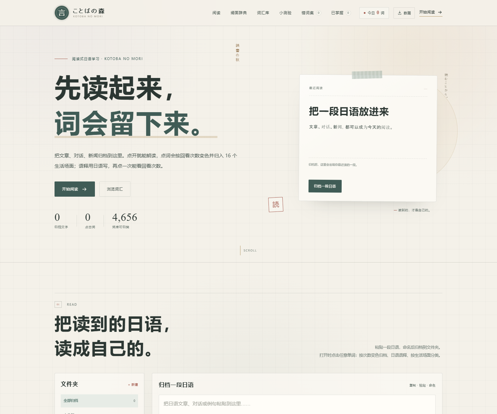
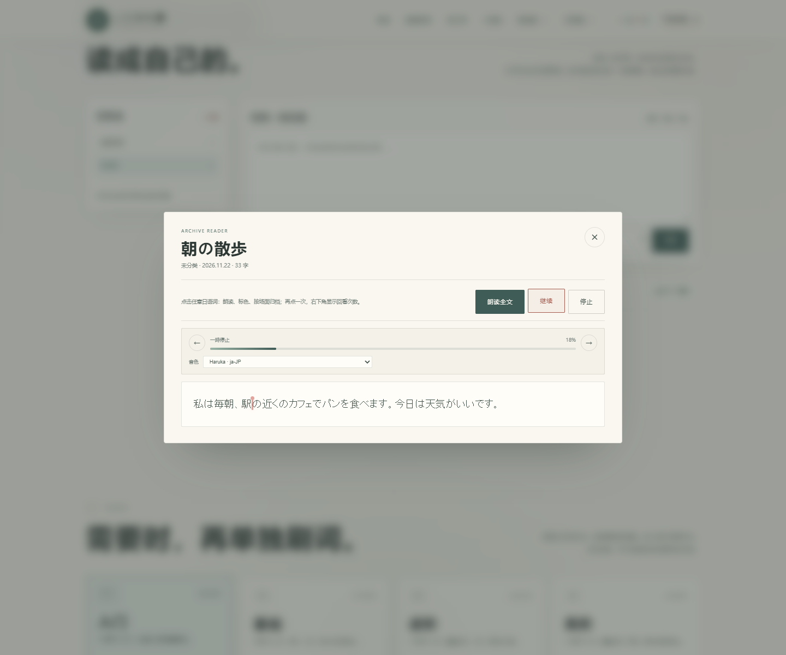

# ことばの森 · KOTOBA NO MORI

一个以「读完一段日语」为中心的日语学习网站。把复制来的日语归档到文件夹，打开就能朗读；点击任意单词，它会按回看次数变色并按**生活场面**归类，用**日语语释**解释。再点一次，右下角会出现这个词的回看次数。

- **4,656 詞**：JLPT N5 / N4 / N3 / N2 词库
- **16 の場面**：人と関係、毎日の暮らし、住まい、食べる・飲む、買い物・お金、学ぶ・学校、働く・会社、町・移動、旅・休み、健康・からだ、自然・天気、趣味・文化、心・考え、社会・ニュース、時間・数量、その他
- **日本語語釈**：全 4,656 詞均有日语语释（其中 2 詞为自动生成的简要说明）；词库外的词单独进入「未収録」
- **再読カウンター**：同一个词第 2 次点击起，右下角显示 `n / 10`；超过 10 次自动归零
- **数据备份**：页头「数据」按钮可导出 / 导入全部归档、点击词、学习进度、错词集与音色偏好



## 打开方式

直接双击 `index.html`，用 Chrome / Edge / Safari 打开即可。除首次加载本地文件外，不需要安装依赖，也不需要联网。

如果浏览器限制 `file://` 下的语音或本地存储，可在当前目录启动任意静态服务器：

```bash
python -m http.server 8080
```

然后访问 `http://localhost:8080`。

## 怎么用

### 1. 归档一段日语

1. 打开「阅读」区域，把日语文章、对话或例句粘贴到文本框。
2. 填写名称（留空会自动取开头文字），选择文件夹，点「归档」。
3. 文件夹可以新建、改名、删除；归档文字也可以改名或删除。
4. 点击归档卡片打开阅读器。

### 2. 朗读

- 「朗读全文」用浏览器语音合成（`ja-JP`）读整段。
- 朗读时文字上会出现一条**红色光标**，跟着当前朗读位置移动；暂停时光标停在原处并闪烁。
- 进度条跟随语音移动；左右按钮或键盘 `←` / `→` 可以前后跳约 10%，点击进度条可直接跳转。
- 「暂停 / 继续」按钮暂时停下或继续朗读。


- 音色下拉框会列出当前浏览器可用的日语语音；选择后会记住，下次打开继续使用。
- 点击单词也会读这个词。
- 「停止」立即停止朗读。
- 手机上建议用较新的 Chrome / Safari / Edge；不同系统的日语语音音色会不同。

### 3. 点词、变色、归档

点击阅读器里的任意日语词：

- 词在 4,656 詞内：按回看次数变色，归入 16 个生活场面，显示读音、等级、日语语释、中文提示和例句。
- 词不在词库内：同样按次数变色，单独归入「未収録」。
- 同一个词的不同活用形会合并到同一个词条。例如点「食べます」，归档的是「食べる」。
- 再点一次同一个词：右下角出现回看计数器。
- 1–3 次为绿色，4–6 次为蓝色，7–9 次为紫色，第 10 次为红色。
- 第 11 次点击超过上限，自动回到 `0 / 10`，单词颜色恢复正常。
- 「点击词」里可以按等级、场面筛选，也可以逐词朗读或移出。

所有归档文字、文件夹、点击词和回看次数都保存在当前浏览器的 `localStorage`。

### 4. 导入 / 导出数据

点击页头的「数据」按钮：

- **导出**：下载 `kotoba-mori-backup-日期-时间.json`，包含归档文字、文件夹、点击词与次数、学习进度、错词集、已掌握、测验成绩和音色偏好。
- **导入**：选择之前导出的 `.json`。会先检查格式，再让你选择「合并导入」或「覆盖导入」。
  - 合并：保留当前数据，追加备份里的新内容；同一个词取较高的回看次数。
  - 覆盖：用备份替换当前全部数据，导入前会再次确认。
- 导入成功后页面会自动刷新。

备份只包含本站数据，不包含语音文件。

### 5. 場面辞典

「場面辞典」把 4,656 詞分成 16 个生活场面。点任意场面卡片，会打开该场面的词表：

- 搜索日语、假名、中文或日语语释
- 每个词显示日语语释、读音、等级
- 点击喇叭朗读

### 6. 词汇与测验

- 按 N5–N2 切换等级，按场面、小节、掌握状态筛选。
- 闪卡、小测、错词集、已掌握仍保留；词汇卡以日语语释为主，中文只作为辅助提示。

## 数据与出处

日语语释由以下开放数据整理、缩短和人工校订：

- [日本語版 Wiktionary](https://ja.wiktionary.org/) — CC BY-SA 4.0
- [日本語 WordNet](https://bond-lab.github.io/wnja/) — 日语数据采用类似 BSD 的许可证
- [JMdict](https://www.edrdg.org/jmdict/j_jmdict.html) — 仅用于建立汉字词与读音的对应，不直接展示其英文释义

详细出处、修改说明和许可证链接见 [DATA-SOURCES.md](DATA-SOURCES.md)。

> 语释经过截断和改写，目的是方便中级学习者快速理解；不是完整辞典释义。正式写作或翻译请以专业辞典为准。

## 文件

| 文件 | 说明 |
| --- | --- |
| `index.html` | 页面结构 |
| `styles.css` | 基础布局与组件样式 |
| `theme-modern.css` | 备选「编辑风」主题（当前未加载）：钴蓝、硬边框与网格 |
| `theme-rednote.css` | 备选「奶油手记」主题（当前未加载）：奶油粉、标志红、圆角卡片 |
| `theme-wabi.css` | 当前「月白 / Gekkin」主题：和纸米白、墨色、青磁、朱土、藤色与细线 |
| `data.js` | 等级与词库汇总 |
| `n5-data.js` / `n4-data.js` / `n3-data.js` / `n2-data.js` | 4,656 个词条 |
| `dictionary-data.js` | 16 场面分类、日语语释、汉字读音索引 |
| `app.js` | 归档、朗读、分词与活用还原、点词、计数器、辞典、闪卡、测验 |
| `favicon.svg` | 网站图标 |
| `DATA-SOURCES.md` | 数据出处、许可证与修改说明 |

## 主题

当前使用 **「月白 / Gekkin」**：和纸米白底、墨色文字、青磁与朱土点缀，配藤色和淡金。细线、留白、障子格纹、竖排「読書の秋」和小小的朱印「読」，整体是安静的和モダン（Japanese modern），不靠高饱和色和强阴影。

样式分两层加载：

1. `styles.css` — 基础布局和组件
2. `theme-wabi.css` — 当前「月白」和风主题

另外保留了 `theme-modern.css`（钴蓝编辑风）和 `theme-rednote.css`（奶油手记风）两套备选皮肤，但当前没有加载。想换回去，把 `index.html` 里的 `theme-wabi.css` 替换成对应的文件名即可。

## 已知限制

- 语音合成依赖操作系统/浏览器提供的日语语音；没有日语语音时，浏览器会退回默认语音或无声。
- 分词以 `Intl.Segmenter` 为基础，再用词库做合并与活用还原；极少数专有名词或口语可能仍被归入「未収録」。
- 词库中的词条来自 JLPT 教材词表，部分词条的场面归类按词义做了自动修正，仍可能有少量不准确。
- 所有学习记录只存在当前浏览器；清理站点数据会一并清除。
